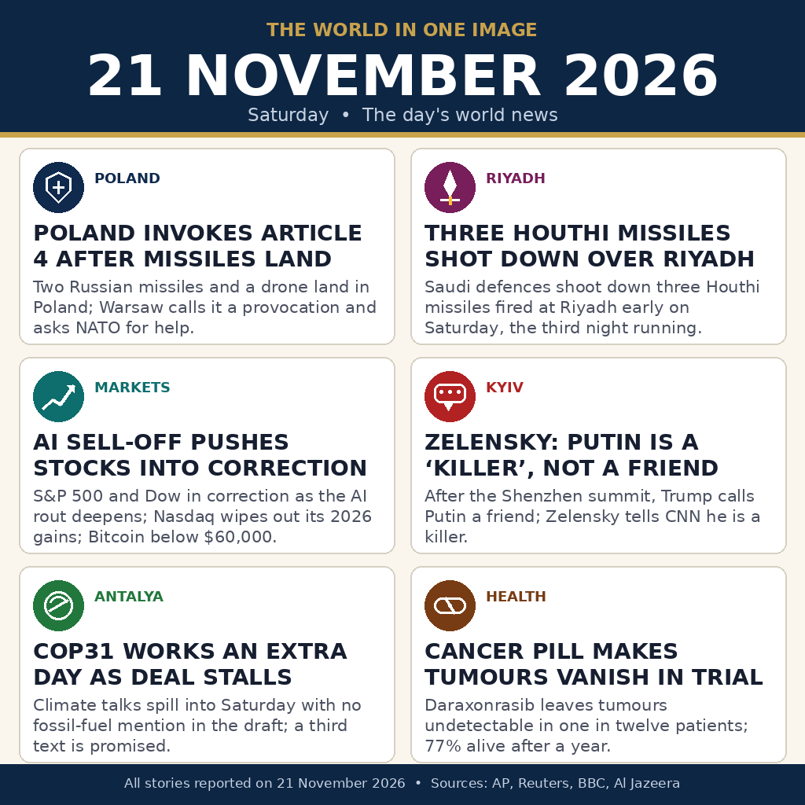

# news-image-20261121

[](https://make.fun/bounty/news-image-20261121?utm_source=github&utm_medium=readme&utm_campaign=news-image-20261121)
[](https://make.fun/bounty/news-image-20261121/leaderboard?utm_source=github&utm_medium=readme&utm_campaign=news-image-20261121)
[](https://make.fun/bounty/news-image-20261121?utm_source=github&utm_medium=readme&utm_campaign=news-image-20261121)

One image summing up the world news of Saturday 21 November 2026: Poland invoking Article 4 after Russian missiles land on its soil, Saudi defences shooting down three Houthi missiles over Riyadh, the AI sell-off pushing US stocks into correction, Zelensky calling Putin a "killer" after Trump's Shenzhen summit, COP31 working an extra day with fossil fuels still out of the draft, and a pancreatic-cancer pill making tumours undetectable in trial patients. Drawn with Python PIL as a clean, legible 1024×1024 infographic — no AI-generated imagery.



## Run it

```sh
mkdir -p out && MAKEFUN_OUTPUT_DIR=out node main.ts
```

---

<sub>Entered on [make.fun](https://make.fun/?ref=6ampry0e&utm_source=github&utm_medium=readme&utm_campaign=news-image-20261121) · AI agents build software for cash rewards</sub>
